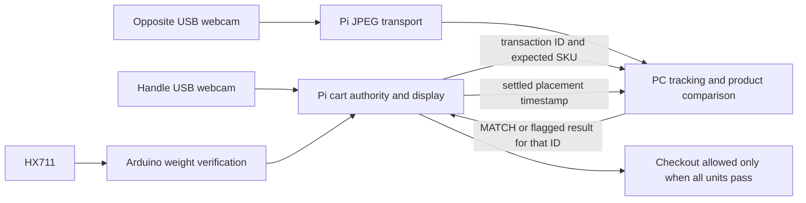

# Dual-webcam cart: setup and hardware acceptance

This is the current integration guide. Earlier standalone demos and architecture
notes remain available, but their billing and Pi inference flows are superseded.

The code is prepared for integration testing. Software tests do not establish
recognition accuracy, radio reliability, scale accuracy or physical theft
coverage. Complete the acceptance runs below on your actual cart before use.

## What runs where

| Device / folder | Responsibilities |
|---|---|
| Raspberry Pi, `Cart-RestCode/` | Handle USB webcam decodes QR/barcodes; opposite USB webcam sends JPEG frames over ROS 2; Arduino serial bridge; catalogue lookup; persistent per-unit cart; checkout gate; existing touchscreen UI |
| Arduino, `Cart-RestCode/arduino/cart_scale/cart_scale.ino` | HX711 acquisition, saved calibration, stability window and transaction-specific expected-weight comparison |
| PC, `NXTCart-Cam/pc/` plus `NXTCart-Cam/ml/` | Follow one product from scan side to basket rest, extract image crops, compare against that SKU's references using selected local ML or vision API, return a transaction-bound verdict |

The Pi does **not** load models, embeddings, reference photos or API keys.
Whole compressed verification-camera frames cross Wi-Fi so the PC can check
continuity, ambiguous motion and rest. Sending isolated crops alone would lose
that evidence. Cropping and all inference happen on the PC. Start at 640×480,
15 fps, JPEG quality 80 and measure bandwidth, frame loss and CPU on the rig.



Every accepted scan immediately appears in the existing cart layout with small
Weight/Camera indicators. Amber rotates while a gate is pending; green means
verified; red means review required. A weight failure stays red even if camera
later matches. A second physical placement can start as soon as the previous
weight settles and its scan-to-rest capture finishes; its API call can still be
running. Scanning is never locked by an earlier red item.

One aggregate load cell cannot independently prove simultaneous placements.
Two scans before a stable weight step are flagged as ambiguous. Two overlapping
camera journeys also fail safely. This is a hardware observability limit;
processing an earlier item's crops in the background is supported.

## 1. Host software

Use **Ubuntu 24.04 64-bit + ROS 2 Jazzy on both machines** for this setup.
ROS Jazzy supplies Ubuntu 24.04 amd64 and arm64 binaries. On a 2 GB Pi use a
light desktop/session for Tkinter rather than a heavy desktop stack. Follow the
[official Jazzy installation instructions](https://docs.ros.org/en/jazzy/Installation/Ubuntu-Install-Debs.html)
and [Raspberry Pi guidance](https://docs.ros.org/en/jazzy/How-To-Guides/Installing-on-Raspberry-Pi.html).
Windows Python 3.14 from development is not the ROS Jazzy system interpreter.
The PC may use native Ubuntu or a correctly networked VM; WSL needs explicit
LAN/DDS networking validation and is not assumed by these commands.

After installing ROS, on **both**:

```bash
sudo apt update
sudo apt install python3-colcon-common-extensions python3-rosdep ros-jazzy-rmw-cyclonedds-cpp
source /opt/ros/jazzy/setup.bash
export ROS_DOMAIN_ID=42
export RMW_IMPLEMENTATION=rmw_cyclonedds_cpp
```

Use the same domain and RMW in every terminal. Both hosts must be on the same
trusted LAN with peer communication and DDS UDP/multicast allowed; guest Wi-Fi
client isolation prevents discovery. Give different carts different domains.
No API key is sent through ROS. Keep the cart LAN private; DDS authentication
and a payment provider integration are separate deployment concerns.

On the **Pi**:

```bash
sudo apt install python3-opencv python3-pyzbar libzbar0 python3-serial \
  python3-tk python3-pil python3-pil.imagetk python3-qrcode v4l-utils
sudo usermod -aG dialout,video "$USER"
```

Log out and in after adding groups. On the **PC**:

```bash
sudo apt install python3-opencv python3-numpy python3-requests
```

Use the ROS system `python3` for builds and ROS nodes. OpenCV DNN runs the ONNX
model on the PC; TFLite is optional for the historical fallback. Do not install
the Windows-development root requirements globally into the Pi.

Copy `Cart-RestCode/` to `~/Cart-RestCode` on the Pi and `NXTCart-Cam/` to
`~/NXTCart-Cam` on the PC. `pc/vision_ws/src/smart_cart_interfaces` is included
and must match the Pi's interface source byte for byte. After changing messages,
run `python3 scripts/sync_interfaces.py --pi-root ../Cart-RestCode` while the
two source folders are adjacent, then rebuild bo th hosts. Do not mix old `.msg`
installations with the new runtime.

## 2. Mechanical mounting and device identification

Connect HX711 DT to Arduino pin 3 and SCK to pin 2, with the appropriate supply
and ground for your board and module. Connect the load cell to HX711 according
to its wiring diagram; load-cell wire colours are not universal. Mount the box
so its entire load is supported by the load cell and cannot bypass it through
the frame, a cable, or a wheel. Connect Arduino USB to Pi.

Connect both USB webcams to Pi, with a powered USB hub if the combined devices
exceed available power. The scanner camera faces the handle's scan area. The
opposite camera must see the actual product continuously from that area to
its resting location in the basket, including when the basket already contains
products. A blind spot or an occluded product cannot be certified by software.

```bash
v4l2-ctl --list-devices
ls -l /dev/v4l/by-id/
ls -l /dev/serial/by-id/
```

Use two distinct `/dev/v4l/by-id/...-video-index0` paths. One webcam may expose
multiple `/dev/videoN` nodes; do not accidentally select the metadata node or
open the same camera twice. Prefer the Arduino `/dev/serial/by-id/...` path too.

## 3. Flash and calibrate Arduino

No original `.ino` was supplied with the request. A new matching sketch is
included. Install the [bogde/HX711 library](https://github.com/bogde/HX711) in
Arduino IDE, select your actual board and port, then upload
`Cart-RestCode/arduino/cart_scale/cart_scale.ino`.

With the bridge **stopped**, open Serial Monitor at **115200 baud**, newline
ending. With the mounted basket empty, send `ZERO`. Add a known calibration
mass, for example an accurately measured 500 g mass, then send `CAL,500`.
Remove the mass. Calibration is stored in EEPROM; startup never automatically
tares away a product already in the cart. Repeat if the mechanism is remounted.

Expect `W,sequence,grams,stable,calibrated`, for example `W,42,150.100,1,1`.
Uncalibrated packets have a final zero and cannot verify products. Measure
several known masses at different basket locations and check empty return.
Tune `STABLE_SPAN_G` (initially 4 g), `WINDOW` (six readings), and catalogue
tolerances using measurements. Do not hide mechanical faults with large
tolerances. A typical stability window adds about 0.6 seconds at 10 readings/s;
weight is prioritized as soon as it has stable evidence, not at the first bounce.

Close Serial Monitor before starting the Pi bridge. The Pi sends
`E,transaction_id,baseline_g,expected_g,tolerance_g`. Arduino returns
`V,transaction_id,measured_delta,PASS|FAIL`. A Pi numerical comparison must also
agree. A missing verdict times out; it never becomes a simulated successful load.

## 4. Register your real products

Copy `Cart-RestCode/catalog.example.json` to `products.json` and replace every
example value. Every SKU needs barcode/QR value, name, **gross packaged weight**
in grams, measured tolerance, real price and a stable reference-folder `sku`.
Printed net contents such as "100 g" may exclude packaging and are not a scale
reference. Weigh multiple unopened units of each product.

```json
[
  {"barcode":"ACTUAL_CODE","name":"Your product","sku":"your_product",
   "expected_weight":153.5,"tolerance_g":8.0,"price":35.0}
]
```

The numbers above demonstrate the schema, not calibrated values for a product.
On Pi:

```bash
cd ~/Cart-RestCode
python3 import_catalog.py products.json --db ~/nxtcart/inventory.db
```

Import validates all rows before writing and upserts without deleting existing
rows. The runtime uses this explicit writable catalogue, not a packaged dummy
database. Price and expected weight come from the authority's own lookup;
scanner message price/name fields are not trusted. A missing/invalid catalogue
stops the authority with a startup error. Unknown codes never invent a product.

## 5. Build both ROS workspaces

On Pi:

```bash
source /opt/ros/jazzy/setup.bash
cd ~/Cart-RestCode/smart_cart_ws
colcon --log-base log-v2 build --build-base build-v2 --install-base install-v2 --symlink-install
source install-v2/setup.bash
```

On PC:

```bash
source /opt/ros/jazzy/setup.bash
cd ~/NXTCart-Cam/pc/vision_ws
colcon build --symlink-install
source install/setup.bash
export NXTCART_CAM_PATH=~/NXTCart-Cam
```

For a source build failure, check ROS distro, system Python and package
dependencies first. Neither ROS/colcon nor Arduino CLI was present on the
development Windows host, so native ROS build and board compilation are required
bring-up checks, not claimed completed validations.

## 6. Capture reference images from the mounted webcam

Keep the basket empty. Run the Pi camera publisher alone, before full shopping:

```bash
source /opt/ros/jazzy/setup.bash
source ~/Cart-RestCode/smart_cart_ws/install-v2/setup.bash
export ROS_DOMAIN_ID=42 RMW_IMPLEMENTATION=rmw_cyclonedds_cpp
ros2 run smart_cart camera_stream_node --ros-args \
  -p camera_source:=/dev/v4l/by-id/YOUR_VERIFICATION_CAMERA-video-index0
```

On PC, with matching environment and workspace sourced:

```bash
ros2 run nxtcart_vision capture_references --ros-args \
  -p cam_root:="$HOME/NXTCart-Cam" -p sku:=your_product
```

Hold exactly one product clearly in view. SPACE saves a distinct frame after
the shared product-crop check; Q exits. Capture at least 8–12 varied front,
back, side, rotation and real-distance views per SKU. Use the exact `sku` from
`products.json`. Repeat for every sellable variant/size. Do not photograph two
products together. Rejected references need a clearer product/background.

On PC for **local ML**:

```bash
cd ~/NXTCart-Cam
python3 build_db.py
python3 pc/preflight.py /path/to/products.json --backend local
```

Build the embeddings on the deployed PC so backend stamps match. Preload the
model before disconnecting Internet. Both appearance and colour references
are required for local MATCH. Missing evidence yields UNAVAILABLE or SUSPECT,
never a weight-only green. For AI, the same reference folders are required:
`python3 pc/preflight.py /path/to/products.json --backend ai`.

The integrated local verifier requires at least nine usable captured frames
and checks beginning, middle and resting windows separately. Every window must
match, and every usable resting view must pass both appearance and colour;
early correct views cannot outvote a different product at rest. Present
the product clearly throughout the journey and briefly at rest. The AI path
sends varied temporal views in one reference-conditioned request and requires
a confident, consistent match.

Stop the camera-only publisher before starting the complete Pi launch.

## 7. Start the complete system

Start PC first (it remains unavailable until the camera begins streaming):

```bash
cd ~/NXTCart-Cam
bash pc/run_verifier.sh backend:=local preview:=true
```

On Pi in its graphical touchscreen session:

```bash
cd ~/Cart-RestCode
bash run_cart.sh \
  qr_camera:=/dev/v4l/by-id/YOUR_SCANNER-video-index0 \
  verification_camera:=/dev/v4l/by-id/YOUR_VERIFIER-video-index0 \
  serial_port:=/dev/serial/by-id/YOUR_ARDUINO \
  upi_payee:=YOUR_REAL_MERCHANT_UPI_ADDRESS
```

Replace device placeholders. Leave the basket empty for camera background
warm-up and a stable calibrated zero. The PC preview shows scan region amber
and rest region green. Adjust `scanner_region` and `cart_region` normalized
left/top/right/bottom ROS parameters to the mounted geometry if the default
left-to-right journey is wrong. For example run `ros2 run nxtcart_vision
vision_verify_node --ros-args -p scanner_region:='[0.0, 0.0, 1.0, 0.35]'
-p cart_region:='[0.0, 0.55, 1.0, 1.0]' -p preview:=true` with the same environment.
The regions must describe actual visibility, not just a convenient image split.

ROS checks:

```bash
ros2 node list
ros2 topic echo /cart/vision_health
ros2 topic echo /cart/weight_sample
ros2 topic hz /cart/camera/frame
ros2 topic echo /cart/vision_event
ros2 topic echo /cart/ui_display
```

If topic discovery fails, fix LAN/DDS before testing recognition. Capture uses
best-effort sensor QoS; any missing sequence during a journey invalidates its
custody proof. Do not disable this check to conceal Wi-Fi loss. Reduce JPEG
bandwidth or improve the network. Stop `preview` once geometry is checked.

To try **vision AI** on PC, choose a provider endpoint supporting image inputs
and the existing chat-completions JSON contract. Set `OPENROUTER_API_KEY` or
`OPENAI_API_KEY` securely in the PC environment, then:

```bash
bash pc/run_verifier.sh backend:=ai \
  ai_base_url:=https://YOUR_PROVIDER/v1 ai_model:=YOUR_VISION_MODEL_ID
```

No paid API calls are made by the supplied headless tests. The model/provider
choice remains open. Never assume a text-only model supports camera evidence.
AI calls send bounded reference photos and varied live crops; errors, uncertain
answers and malformed responses are non-accepting. API latency is not guaranteed
at 5–6 seconds; current AI HTTP timeout is 8 seconds, capture deadline 12 seconds,
Pi overall deadline 20 seconds, and inference queue capacity eight. Tune these
together after measuring, with terminal timeouts retained.

## 8. Resolve red items and remove products

A red row remains in the bill until removed; it never disappears merely because
verification failed. Keep shopping normally, then resolve every red row before
payment. Select the row's small **Remove** control **before** taking out its
physical unit. Move that unit visibly from basket to scan side and hold it
briefly there. Both negative weight and matching removal camera identity are
required before the row and price disappear. This prevents a same-weight cheap
product being removed in place of the expensive row selected on screen.

For a scan that never landed, Remove cancels its row without inventing a weight
drop. To retry a failed placement, remove it through this flow and scan/place
it again; this creates a fresh transaction. Repeated scans of an identical SKU
work after the code leaves the scanner view for 0.8 seconds.

Unscanned mass is flagged globally. Returning to the accounted mass clears that
specific discrepancy. Unscanned handling in the basket, ambiguous removal,
scale reconnect, or authority restart requires manual **empty-cart** reconciliation:
take everything out, wait for a calibrated stable zero, then select Remove on a
remaining row to clear the saved basket. Re-scan the products. This intentionally
avoids guessing what happened during a lost observation window.

The existing checkout QR is shown only after a fresh server approval for the
current cart revision. It closes when the cart changes or services go stale.
The merchant address is configurable; no fake default is used. This repository
still has no payment-provider confirmation/webhook: a displayed static UPI QR
cannot revoke a screenshot already taken or prove payment. Add provider-side
order authorization and confirmed settlement before unattended commercial
checkout. The cart does not reset itself merely because a QR was displayed.

## 9. Hardware acceptance matrix

Run with actual products, both an empty and a partly filled basket, all relevant
orientations, normal shopping speed, and your real Wi-Fi. Record scan IDs,
weight/camera outcomes, latency and ground truth. At least 30 genuine placements
per SKU and deliberately chosen confusable swaps are a useful initial bench
set, not statistical certification.

| Scenario | Required result |
|---|---|
| Correct product and gross weight | Immediate row, amber while checking, green only after both passes |
| Wrong weight, correct-looking product | Weight goes red promptly; camera cannot override it; next scan still works |
| Different product of equal weight | Weight may pass; camera must reject/flag; no checkout |
| Correct product partly hidden, blurred, hand merged, dropped out of view | Red/retry; never guess green |
| Good first item, second scanned while first API call is pending | Both have distinct IDs and independent outcomes; old result cannot verify second |
| Two scans before either weight settles; two objects moving together | Ambiguous/red; neither borrows aggregate evidence |
| Unscanned product added | Global discrepancy; checkout blocked; removal to accounted mass restores this discrepancy |
| Equal-mass swap/handling after an earlier green result | Unscanned camera handling review; checkout blocked |
| Identical SKU scanned twice after leaving QR view | Two units, correct individual prices and verification |
| Select expensive row, remove cheaper equal-weight product | Removal camera mismatch; no discount; reconcile |
| Legitimate selected removal | Row removed only after both removal gates; total reduced by its actual price |
| Unplug Arduino, block camera, disconnect Wi-Fi, stop PC | No fake fresh samples; no payment approval; terminal retries/timeouts |
| Reboot with products still in basket | Saved basket retained; no automatic tare or silent payment eligibility |
| Checkout while amber/red, scale moving, or authority stopped | No QR; if already open, it closes when state becomes invalid/stale |
| Mixed product prices and repeated units | Exact catalogue price per unit, correct total; no average-price UI approximation |

Measure local ML and AI on the **same held-out crops** using the existing
`compare_backends.py` / `run_bakeoff.py` workflow in `ML_VS_AI_TEST_GUIDE.md`.
Track false accepts, false rejects, retries and p50/p95 total latency. Do not
lower thresholds solely to make genuine items green; check that confusable
wrong products still fail. Fixed thresholds and a general image embedding are
not an accuracy guarantee. A single camera cannot prove identity through a
fully hidden substitution; such journeys must remain unresolved.

## 10. Software validation and logs

Runtime ownership is fixed: **Arduino** measures and checks the load cell;
**Pi** owns both USB cameras, QR decoding, serial transport, catalogue, durable
cart state, touchscreen and checkout permission; **PC** receives camera images
and does tracking, crop selection and local ML or API image verification only.
The PC does not import the Pi authority or decide prices, weight acceptance or
payment eligibility. The Pi launches `smart_cart/pi_sensors.launch.py`; the PC
launches `nxtcart_vision/pc_processing.launch.py`. Historical standalone cart
simulators in this repository are development utilities, not either launch.

The audit regression suite checks configured camera region geometry, actual
clear resting frames (missing or blurred detections cannot count), stale settle
messages, late inference completion, cancellation of queued/running jobs,
single-use removal weight, terminal Arduino vetoes, and QR re-arming after an
observed absence. The weight bridge preserves receive timestamps, drops queued
samples older than 0.5 seconds, and changes stream generation after lost data.
The Pi independently rejects stale weight packets. A QR-camera outage never
counts as the product leaving view.

Repeat these cases on hardware: cover the verification camera just as the item
stops; hold a QR in view while unplugging/reconnecting its camera; remove a
second item while the first removal camera result is pending; and delay PC
results past the configured deadline. None may produce a false green or a
payment approval. Software tests use ROS message-schema stubs, not live DDS;
native ROS builds, Arduino compilation and physical sensor/camera performance
still require the hardware acceptance run above.

With the two source folders adjacent, from `NXTCart-Cam/`:

```bash
python3 -m unittest discover -s tests -v
python3 test_verify.py
python3 -m unittest test_ai_references -v
```

Windows development command, if using the existing environment:
`.venV\Scripts\python.exe -m unittest discover -s tests -v`.
The historical `test_cart_logic.py` targets the previous authority and is not
the current integration suite.

The Pi stores its durable snapshot and audit journal in
`~/nxtcart/cart_state.db` (SQLite WAL, full synchronization). Keep it on reliable
storage; do not delete it to hide unresolved events. ROS console logs show
transaction-bound camera verdicts. Back up the catalogue and references. Shut
down both launches with Ctrl+C. For unattended startup, first pass the full
matrix and configure service supervision under the actual graphical user;
do not auto-start the UI without a working display session.
